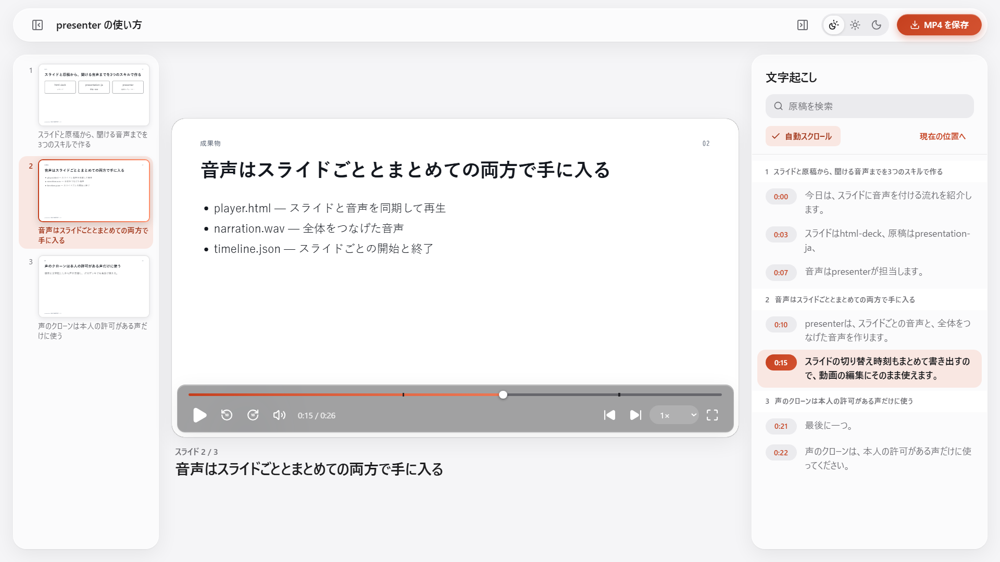

# presenter

スライドと発表原稿から、**ナレーション付きのプレゼン**を手元のGPUで作るAgent Skill集です。
エージェントに「このスライドに私の声でナレーションを付けて」と頼むと、スライドを見ながら聞けるプレーヤーと、そのまま配れるMP4ができます。

<picture>
  <source media="(prefers-color-scheme: dark)" srcset="docs/images/player-dark.png">
  
</picture>

## できること

- **スライドを自動で読み上げる**: [html-deck](https://github.com/nogikun/html-deck)のスライドに、presentation-jaで書いて検査した原稿を、スライドごとに音声にします。
- **見ながら聞けるプレーヤー**（`player.html`、ダブルクリックで開けます）
  - PowerPointのようなスライド一覧と、YouTubeのような文字起こしが並びます。話している文が強調され、スライドも自動で切り替わります。
  - 文字起こしの文をクリックすると、その文から聞けます。原稿の検索とコピーもできます。
  - 全画面（ウィンドウいっぱい／モニター全体）、ライト／ダーク、速度の切り替えに対応します。スライド一覧と文字起こしは閉じられます。
  - 読み上げの声を切り替えられます。`presenter-tts play <deck>`で開くと、まだ音声のない声を選んだときにその場で作ります。
- **MP4に書き出す**: スライドと音声を合わせた1920×1080の動画を作ります。
- **自分の声で読ませる**: 5〜30秒の録音から声を登録できます（本人か、本人の許可を得た声だけ）。
- **手元で完結**: 音声合成は量子化したFish Audio S2 Pro（[s2.cpp](https://github.com/rodrigomatta/s2.cpp)）をローカルのGPUで動かします。原稿や声を外部のサービスに送りません。

```
html-deck（スライド） → presentation-ja（原稿の作成と検査） → presenter（音声・プレーヤー・MP4）
                                                              ↑ presenter-setup（エンジンの準備）
```

| スキル | 役割 |
|---|---|
| [`presentation-ja`](skills/presentation-ja/SKILL.md) | 聞き手・目的・資料・持ち時間から日本語の発表原稿を作り、検査する。html-deckのスライドごとに原稿を紐づける |
| [`presenter`](skills/presenter/SKILL.md) | 検査済みの原稿を音声にして、プレーヤーとMP4を作る。声のクローン、文章の読み上げ、OpenAI互換の音声APIも |
| [`presenter-setup`](skills/presenter-setup/SKILL.md) | 前提ソフトの確認と導入、ライセンスの確認、s2.cppのビルド、モデルの取得、動作確認を、エージェントが進める |

スライドを作る`html-deck`は別のリポジトリのスキルです。

## はじめかた

```sh
npx skills add nogikun/presenter
```

入れたあとはエージェントに頼みます。

1. 「presenterをセットアップして」 → presenter-setupが環境を調べ、必要なものを（承認を得てから）入れ、エンジンをビルドします（初回は約30分）
2. 「html-deckでスライドを作って、presentation-jaで原稿も作って」
3. 「そのスライドに私の声でナレーションを付けて」 → presenterが音声とプレーヤーを作ります（生成は発表の長さの約1.4倍の時間がかかります）
4. 「MP4にも書き出して」 → `presentation.mp4`ができ、プレーヤーにも「MP4 を保存」が出ます

できあがるもの（`<deck>/narration/`）:

| ファイル | 中身 |
|---|---|
| `player.html` | スライド一覧・再生操作・文字起こしのあるプレーヤー。`player.html#t=95`で95秒の位置から開けます |
| `presentation.mp4` | スライドと音声を合わせた動画（H.264/AAC、頼んだときだけ） |
| `narration.wav` | 全スライドをつなげた音声 |
| `timeline.json` | スライドごと・文ごとの開始と終了の秒数 |
| `audio/<スライドID>.wav` | スライドごとの音声。原稿を直すと、変わったスライドだけ作り直します |

presenterのコードは`skills/presenter/tools/`（uvのプロジェクト）にあり、`uv run --project "<presenter>/tools" presenter-tts narrate "<deck>"`や`presenter-tts video "<deck>"`のように直接使うこともできます。
コマンドの一覧は[commands.md](skills/presenter/references/commands.md)、プレーヤーとMP4の詳細は[playback-video.md](skills/presenter/references/playback-video.md)にあります。

## 必要な環境

- Windows 10/11、NVIDIA GPU（VRAM 6 GB以上。RTX 3080で確認）、CUDA Toolkit 12.4以上
- uv、Git、FFmpeg、Visual Studio C++ ビルドツール（presenter-setupが確認し、足りなければ承認を得てから入れます）
- MP4の書き出しには、ChromeかEdge

## ファイルの置き場所

エンジン・モデル・声はユーザー共通の`%LOCALAPPDATA%\presenter-tts`に置き、どのプロジェクトからも共有します（環境変数`PRESENTER_TTS_HOME`で変更可）。スキルを更新しても消えません。

| 場所 | 中身 | 消してよいか |
|---|---|---|
| `cache/` | s2.cpp、ビルド、モデル（約3.6 GB）、ログ、フィラー | よい（presenter-setupで取り直せる） |
| `voices/` | 登録した声と元の録音 | 消さない（取り直せない） |
| `config.toml`、`api-key.txt` | 設定とAPIキー | 確認してから |

片付けの手順は[cleanup.md](skills/presenter/references/cleanup.md)にあります（エージェントに「presenterを片付けて」と頼めます）。

## 声のクローンについて

自分の声か、本人から許可を得た声だけを登録してください。

## 開発

- presenterのテスト: `uv run --project skills/presenter/tools python -m unittest discover -s skills/presenter/tools/tests`
- presentation-jaの評価: [評価アーキテクチャ](docs/presentation-skill-architecture.md)、[検証結果](dev/presentation-ja/validation.md)
- presenterの評価課題: [dev/presenter/evals.json](dev/presenter/evals.json)

ローカルから導入する場合は `npx skills add . --skill presenter` のように実行してください。

## ライセンス

このリポジトリのコードは[MITライセンス](LICENSE)です。
プレーヤー（`player.html`）に埋め込んだアイコンは[Lucide](https://lucide.dev)（ISCライセンス、一部はFeather由来でMITライセンス）で、ライセンス表記はそのファイル内にあります。

s2.cppとFish Audio S2 Proのモデルは同梱していません。presenter-setup（`setup-s2.ps1`）が利用者の環境に取得します。
これらは**Fish Audio Research License**で提供されており、研究・非商用の利用は無償、商用利用にはFish Audioとの別途の契約が必要です。
詳細は取得後の`%LOCALAPPDATA%\presenter-tts\cache\s2.cpp\LICENSE.md`を参照してください。

> This model is licensed under the Fish Audio Research License, Copyright © 39 AI, INC. All Rights Reserved.
