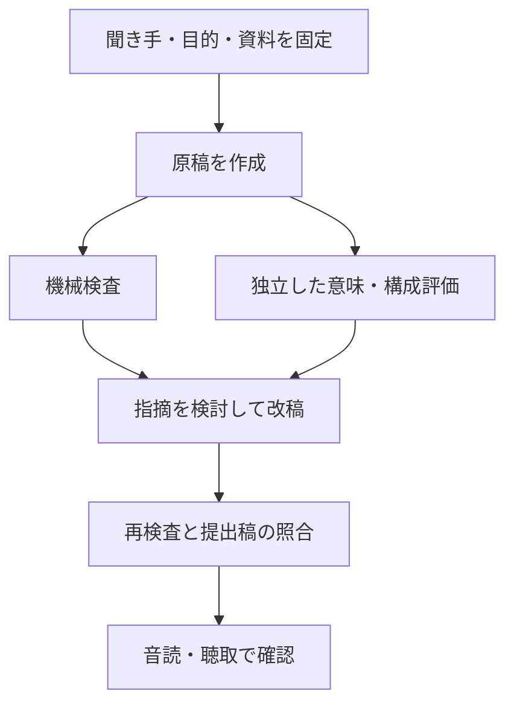

# 日本語プレゼン原稿スキルの評価設計

`presentation-ja` は、日本語の発表原稿を作り、資料との一致と発表の準備状況を確認するスキルです。
構成、話し言葉、演出、評価を分け、機械検査で分かることと、評価者が判断することを区別します。

## yomiyasuから参考にした設計

参照リポジトリ: https://github.com/nanaism/yomiyasu

調査対象のコミット: `fbe02c93877d697cc53d9377b7a45dd8a1dd99b3`。
文章の推敲規則や検出パターンを移植せず、次の設計を参考にしました。

| 確認した資料 | 学んだこと | 今回の設計 |
|---|---|---|
| `docs/tools.md` | lint、差分、統合実行、最終稿照合を分ける | 形式・資料照合候補・時間概算を一つのCLIで実行し、receiptで提出ファイルを照合 |
| `docs/tools.md` / `evals/comparison_benchmark.md` | lintの減点を文章品質の合格点にしない | 機械チェックは観測結果だけ。独立評価と人の聴取は別欄 |
| `scripts/benchmark_corpus.py` | コーパスの由来を誤ると比較の意味が変わる | 今回の例はすべてsynthetic。人が書いた原稿・実測結果とは表示しない |
| `scripts/build_corpus.py` | 保存済み出力の再計測とモデル再生成は別工程 | prepare、生成、collectを分離。既存runの再生成は拒否 |
| `docs/limitations.md` | 検出しない意味変更や、調整に使ったデータの限界を残す | 未検出でも意味保持は未評価。developmentとholdoutを分ける |
| `.github/workflows/ci.yml` | 配布内容と開発内容の整合性、回帰テストを実行する | 配布する検査コードを一か所に置き、テストが直接読む。実装の複製は作らない |

原文のコードやコーパスはコピーしていません。今回のコードと教材は本リポジトリのMITライセンスで配布します。
上記の参照先は、スキル効果の根拠や比較対象の実走結果ではありません。

## 配布と開発を分ける

| 場所 | 役割 |
|---|---|
| `skills/presentation-ja/SKILL.md` | 発動条件と原稿作成の手順 |
| `skills/presentation-ja/references/` | 構成、出力形式、評価基準 |
| `skills/presentation-ja/scripts/presentation_check.py` | Python標準ライブラリだけの検査・提出稿の照合 |
| `dev/presentation-ja/evals.json` | 合成の評価課題。開発用と保留用を区別 |
| `dev/presentation-ja/evaluate.py` | 入力固定、保存済み出力の収集、盲検用の割り当て |
| `tests/test_presentation_skill.py` | 検査器と評価ツール自体の回帰テスト |
| `.runtime/presentation-ja-workspace/` | 試行ごとの入力、生成出力、検査、独立評価、閲覧用HTML |

## 原稿の経路



機械検査の `hard_errors` は、JSON形式や引用抜粋の不存在などを示します。
`review_findings` は数値、長い文、略語、時間の見直し候補です。
引用が資料内に存在することと、その引用が本文の主張を裏づけることは別です。
同じ数字を別の対象へ付け替えた場合や否定を反転した場合も、意味評価が必要です。
数値候補の検査は主にアラビア数字を対象とし、漢数字との対応、単位、計算の妥当性は保証しません。

`receipt.json` は入力、原稿、検査コード、スキルと参照文書、提出ファイルのSHA-256を残します。
`verify` はそれらを再計算し、検査した版と提出する版の不一致を検出します。
署名や悪意ある改ざんに対する証明ではなく、作業中の取り違えを検出するものです。

## 時間は概算と実測を分ける

概算は本文中のUnicodeの文字・数字を数え、設定した文字速度と明示した間から幅を出します。
演出指示、資料、見出し、主メッセージ欄は数えません。
既定の240〜360字/分は工学的な初期値で、日本語話者の標準として実証した値ではありません。
読みの長い英字、桁数、言い直し、図を見る時間などは正確に扱えません。

全体の音声がある場合はその長さを別に記録し、明示した間を二重に加算しません。
実測時間が持ち時間を超えた場合は未解決の指摘です。
時間内でも聞き手が理解できるとは限らず、聴取結果は別に記録します。

## html-deckとの接続

スライド単位で対応づけます。`html-deck`がスライドの制作と画面上の検査を担い、
`presentation-ja`が各スライドの本文、演出指示、時間配分と原稿の評価を担います。
`deck.md`で合意した聞き手・目的・持ち帰る結論を引き継ぎ、同じヒアリングを繰り返しません。

| 対応させる情報 | 役割 |
|---|---|
| `data-slide-id` | 並び順から独立したスライドの安定ID |
| `presentation-map.json` | HTML・構成表・図版などのスナップショットと表示順 |
| `segments[].slide_id` | 発話をスライドへ割り当てる。1枚に複数段落を割り当て可能 |
| `segments[].slide_sha256` | 対応先HTMLを変更した後に、古い原稿を検出 |
| `brief.slide_targets` | スライドごとの時間配分。概算と比較 |

既存HTMLにIDがない場合も対応します。変更のないHTMLのハッシュ、次に同じファイル名でIDを引き継ぎ、
内容と名前を同時に変えた場合は同一スライドだと推測しません。編集を続ける資料では、
`<article class="slide" data-slide-id="problem">`のように明示する方が確実です。

運用は次の順番です。

1. `html-deck`で構成とスライドを作成し、同スキルの`html-deck-check`でビューアを同期・検査する。
2. 下記の`sync`で対応表を作る。原稿の各段落に対応表のIDとHTMLハッシュを付ける。
3. スライドの主張・図解と話す内容の一致、前後のつながり、指示語を別途評価する。
4. `check`で全スライドへの割当、順序、時間配分、出典などを検査する。修正後に`verify`で照合する。

```sh
python skills/presentation-ja/scripts/html_deck_bridge.py sync --deck path/to/deck
python skills/presentation-ja/scripts/presentation_check.py check --deck path/to/deck --brief path/to/deck/narration/brief.json --script path/to/deck/narration/script.json --out path/to/deck/narration/checked
python skills/presentation-ja/scripts/presentation_check.py verify --deck path/to/deck --brief path/to/deck/narration/brief.json --script path/to/deck/narration/script.json --out path/to/deck/narration/checked
```

原稿は`manuscript.txt`、スライド別の本文は`by-slide/<ID>.txt`、演出込みのノートは`speaker-notes.md`、
時間配分と累積時間の概算は`slide-timing.json`に出します。HTMLの画面に原稿を埋め込む必要はありません。
スライド・構成表・CSS・参照する図版を変えたら、対応表を再作成して影響する原稿を見直します。
スライドの増減で出力ファイルの集合が変わる場合は、`checked-v2`など新しい出力先を指定します。

静的な抽出とハッシュ照合は、図解の理解や画面上の配置を検証しません。
画面は`html-deck`、原稿の意味と聞きやすさは原稿側でそれぞれ確認します。
現在は全スライドに発話がある構成が対象です。無言のデモ専用スライドは未対応です。

依頼例: 「html-deckで5分の発表資料を作り、presentation-jaでスライドごとの原稿と時間配分も作って」。

## 比較試験の経路

1. 課題と素材、スキル・検査コードのハッシュを固定します。
2. 同じモデル・設定・出力形式で、スキルあり／なしを作ります。モデルIDや設定を取得できない場合はunknownとします。
3. 欠落や形式不正の出力も残し、都合よく集計対象から外しません。
4. 原稿から手法名と生成者の説明を外し、seedを記録してA/Bへ割り当てます。一度割り当てたものを引き直しません。
5. 独立した文脈の評価者にA→B、B→Aの順で見せます。原稿、素材、事前の基準だけを渡します。
6. 判定が食い違った場合は要確認にし、一方だけを選びません。重大な意味変更は、文体の高さで相殺しません。
7. 人が原稿と評価を読める閲覧用HTMLを作ります。最後に必要なら音読・聴取の結果を加えます。

文字列のチェック数、独立評価の観点別点数、課題のassertionsの合否、実測の聴取結果は混ぜません。
同じモデル系列の評価では自己嗜好が残ります。異なるモデルや人による再評価を推奨します。

## 改善と保留セット

開発用は、初心者向け技術説明、条件付きの提案、研究の限界の報告です。
保留用は、未定情報、過剰な改稿、資料内の命令文を扱うケースです。
保留用は `prepare --split holdout` で明示的に展開します。作成者が設計した例なので、外部の未知データとは呼びません。
保留用を改善に使った場合はその役割を開発用へ変え、新しい保留例を用意します。

スキルの改稿後は新しいrunへ生成し、以前の結果を残して比較します。
一つの失敗に合わせた決め打ち文や、特定単語だけの正解判定は増やしません。
まず、繰り返す失敗が入力の不足、構成、話し言葉、資料との不一致、時間のどこから来るかを確かめます。

## 使い方

リポジトリのルートで次を実行します。

```sh
# インストールする場合（この作業では自動インストールしない）
npx skills add . --skill presentation-ja

# 新しい比較試験の入力を固定。課金やモデル呼び出しは行わない
python dev/presentation-ja/evaluate.py prepare --out .runtime/presentation-ja-workspace/my-run --model actual-model-id

# 各課題のwith_skill/outputsとwithout_skill/outputsへscript.jsonを生成した後に実行
python dev/presentation-ja/evaluate.py collect --out .runtime/presentation-ja-workspace/my-run
python dev/presentation-ja/evaluate.py blind --out .runtime/presentation-ja-workspace/my-run

# 独立評価者がjudge-ab.jsonとjudge-ba.jsonを保存した後に実行
python dev/presentation-ja/evaluate.py summarize --out .runtime/presentation-ja-workspace/my-run

# ローカルの回帰テスト
python -m unittest discover -s tests -p test_presentation_skill.py -v
python -m unittest discover -s tests -p test_html_deck_bridge.py -v
```

`prepare` はモデルの生成を実行せず、`collect` も独立した意味評価を実行しません。
CIもAPIキー不要の回帰テストだけです。モデルの再生成や人の聴取を実施済みと表示しません。
発動判定用の20件は `dev/presentation-ja/trigger-evals.json` にあります。判定の精度測定は未実施です。

## 現時点の限界

日本語の意味解析器、モーラ単位の話速測定、音声合成、実際の聴取評価は実装に含みません。
SSML変換と既存TTSへの接続は別工程です。原稿にモデル固有タグを直接混ぜません。
初回の比較は少数の合成課題による探索的な試行であり、一般的な優位性の証明ではありません。
実行結果と未評価の範囲は `dev/presentation-ja/validation.md` に記録します。
